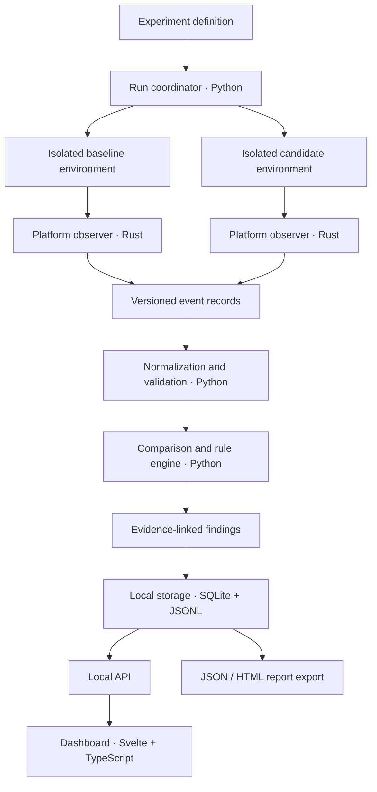

# Driftglass

> **Every update leaves a trace. Find it.**

Driftglass is a planned, open-source, privacy-first application update auditor. It is designed to compare the observable behaviour of two application versions in controlled, isolated environments, then turn their differences into a reproducible report with evidence a person can inspect.

Rather than asking only whether an application has a permission, Driftglass aims to answer a more useful question:

**What changed in the way this application behaves after the update—and what evidence supports that finding?**

It is intended for security researchers, privacy-conscious users, maintainers, and developers who want to investigate application updates before trusting them.

> **Project status:** Early prototype. Versioned event-record v1 and run-manifest v1 contracts, plus Python validators for JSONL events and run manifests, are implemented with synthetic tests. The OS collectors, automated run coordinator, baseline-vs-candidate comparison engine, local persistence/reporting, dashboard, and CLI are not yet implemented. No OS event coverage has been verified.

---

## Contents

- [The idea](#the-idea)
- [Why Driftglass](#why-driftglass)
- [Core principles](#core-principles)
- [Planned capabilities](#planned-capabilities)
- [How a comparison should work](#how-a-comparison-should-work)
- [Architecture](#architecture)
- [Planned technology stack](#planned-technology-stack)
- [Evidence and comparison model](#evidence-and-comparison-model)
- [Event schema](docs/event-schema.md)
- [Run manifest](docs/run-manifest.md)
- [Privacy by design](#privacy-by-design)
- [Security model and limitations](#security-model-and-limitations)
- [Platform strategy](#platform-strategy)
- [Planned repository layout](#planned-repository-layout)
- [Roadmap](#roadmap)
- [Development and testing approach](#development-and-testing-approach)
- [Illustrative future workflow](#illustrative-future-workflow)
- [Contributing](#contributing)
- [License](#license)
- [Disclaimer](#disclaimer)

---

## The idea

Application updates can change more than visible features. A new release may introduce additional network destinations, change which processes it launches, access different files, alter startup behaviour, or request new system capabilities. Release notes and permission lists do not necessarily explain those runtime changes.

Driftglass is intended to make such changes easier to investigate by comparing an application's behaviour before and after an update under controlled conditions.

A comparison should show:

- **What is new:** observed behaviours present in the candidate version but not the baseline.
- **What disappeared:** previously observed behaviours that were not seen in the candidate run.
- **What changed:** behaviours whose destination, resource, frequency, result, or context differs.
- **What is uncertain:** observations affected by noise, missing telemetry, permissions, or platform limitations.
- **Why a finding matters:** the rule that identified it, the supporting evidence, and the limits of the conclusion.

Driftglass is not meant to pronounce software “safe” or “malicious” from a single run. It is an evidence and comparison tool that helps a person ask better questions.

### The central promise

**Compare versions. Inspect the evidence. Understand the difference.**

The project should favour transparent rules, readable findings, repeatable experiments, and honest limitations over opaque scores or dramatic but unsupported security claims.

## Why Driftglass

Many diagnostic tools can show activity during one execution. Driftglass's intended focus is the **relationship between two versions of the same application**.

That focus creates several useful questions:

- Did the update contact a new host or network endpoint?
- Did a process start launching a new child process?
- Did file access or modification patterns change?
- Did the application alter startup configuration or other persistent settings?
- Did a previously observed behaviour stop occurring?
- Can the reported difference be reproduced in another controlled run?
- Is the difference meaningful, or can it be explained by a changed environment?

No single signal proves malicious intent. A new network endpoint could be a legitimate API migration; a new child process could belong to an updater. Driftglass should expose the change, show its context, and explain why a rule raised attention—not pretend that correlation is proof.

## Core principles

### 1. Local-first by default

Captured evidence, application paths, hostnames, and reports can be sensitive. The planned default is to keep collection, comparison, and report generation on the user's machine. No mandatory cloud account or automatic upload should be required.

### 2. Evidence before conclusions

Every finding should link to the observations that produced it. Users should be able to inspect timestamps, event types, process context, destinations, matched baseline behaviour, and the rule explanation.

### 3. Reproducible experiments

Baseline and candidate runs should record their environment and capture configuration. Driftglass should make differences in operating system build, network state, application settings, and collection permissions visible so that users can judge whether a comparison is fair.

### 4. Safe execution boundaries

Unknown or suspicious software should be tested in a disposable virtual machine or another deliberately isolated environment. Driftglass's observer is not, by itself, a security boundary and must never be advertised as one.

### 5. Transparent analysis

Initial comparison and risk rules should be deterministic, documented, and testable. Any future statistical or machine-learning assistance must be optional, explainable, and clearly separated from direct observations.

### 6. Minimal collection

Collect the metadata needed to understand behaviour, not everything that can be collected. Network payload capture and collection of file contents should not be enabled by default.

### 7. Platform honesty

Different operating systems expose different events and require different permissions. Driftglass must identify what was observed, which collector produced the evidence, and which event categories were unavailable in a run.

---

## Planned capabilities

The following are design goals, **not a statement that these features already work**.

| Capability | Intended behaviour | Priority |
|---|---|---|
| Baseline vs. candidate comparison | Compare two versions under documented conditions | MVP |
| Run manifests | Record versions, hashes, environment, settings, and collector coverage | MVP |
| Process and child-process tracking | Show process trees and changes in process creation | MVP |
| Network metadata | Compare observed connections, destinations, ports, protocols, and outcomes where available | MVP |
| File activity | Compare observed file access and modification events where supported | MVP |
| Evidence-linked findings | Explain each rule match and link back to its evidence | MVP |
| Portable exports | Export structured JSON and human-readable HTML reports | MVP |
| Local report history | Keep experiment metadata and results in local storage | MVP |
| Repeat-run comparison | Help distinguish consistent changes from one-off noise | Next |
| Rule profiles | Let users tune checks for different application types | Next |
| Privacy redaction | Redact selected paths, usernames, hostnames, or addresses from exported reports | Next |
| Cryptographic report manifest | Hash report files and included evidence to help detect accidental changes | Next |
| Interactive dashboard | Filter, search, and compare events without losing evidence context | Next |
| Broader OS coverage | Add and validate further platform-specific collectors | Later |
| Baseline sharing | Share redacted, versioned baselines without requiring users to share private machine data | Later |
| Optional advanced correlation | Connect related events while showing the underlying evidence and uncertainty | Later |

### Observation categories

The exact coverage depends on each operating system and collector. The design should account for:

- **Network activity:** destination address or hostname when available, port, protocol, connection outcome, timing, and available byte counts.
- **Process activity:** process creation, parent-child relationships, executable identity, command-line metadata where available, and process exit.
- **File-system activity:** observed reads, writes, creations, deletions, renames, and changes to selected application-related paths.
- **System and persistence changes:** relevant startup entries, services, scheduled jobs, registry settings, or equivalent platform mechanisms where supported.
- **Application and environment metadata:** version identifiers, executable hashes, package metadata, OS build, relevant configuration, and the permissions required for collection.
- **Coverage gaps:** denied access, unsupported event classes, dropped events, and collectors that were not active.

Driftglass must not describe an event category as fully monitored when its collector can only observe a subset of relevant activity.

---

## How a comparison should work

A useful report depends on a fair experiment. The intended workflow is:

1. **Define the experiment.** Choose the application, baseline version, candidate version, operating-system image, capture profile, and test scenario.
2. **Prepare isolated environments.** Use equivalent, clean snapshots or disposable virtual machines for each version. Keep relevant settings and resource limits consistent.
3. **Record the baseline.** Verify the baseline artifact's identity, launch it using a documented scenario, and capture available system events.
4. **Record the candidate.** Repeat the same scenario with the candidate version under equivalent conditions.
5. **Normalize the evidence.** Convert platform-specific events into a versioned internal schema while retaining the original event source and metadata needed for investigation.
6. **Compare behaviour.** Match equivalent events, classify new or missing observations, and identify meaningful changes.
7. **Review findings.** Inspect the rule, evidence, environment differences, confidence, and any known collection gaps.
8. **Export and reproduce.** Generate a report with the experiment manifest, rule-set version, evidence references, and clear limitations.

### Make the comparison fair

Comparisons can be misleading when the runs use different settings, user accounts, OS builds, time windows, or network conditions. An application's first launch may behave differently from a later launch, and server-side behaviour can change without an application update.

Driftglass should therefore record the factors it can observe and encourage identical test scenarios. Where practical, an experiment can include multiple runs of each version. A change that occurs consistently across candidate runs may deserve more attention than an isolated event, but repeatability alone does not establish intent.

The tool should preserve both **raw observations** and **normalized comparisons**. Normalization makes cross-platform analysis possible; retaining the source evidence makes the result auditable.

---

## Architecture

The proposed design separates platform-specific collection from comparison logic and presentation.



The diagram is the target architecture. Boundaries and interfaces may change as prototypes reveal what each operating system can reliably expose.

### Component responsibilities

**Run coordinator — Python**

Owns experiment configuration, coordinates the capture lifecycle, validates run manifests, handles repeated runs, and keeps the comparison workflow understandable. It should not silently elevate privileges or execute an unknown application outside the configured isolation boundary.

**Platform observer — Rust**

Provides the low-level collection layer and platform-specific adapters. Its interfaces should report which event sources are active, what permissions they require, and whether events were dropped or unavailable. Rust is a proposed choice for a small, efficient native component; the exact APIs will be selected and validated per operating system.

**Normalization and rule engine — Python**

Validates incoming records, maps platform events into common categories, matches related baseline and candidate activity, applies documented rules, and creates findings with evidence references. Platform-specific information should not be discarded when it helps explain a result.

**Local storage — SQLite and JSONL**

SQLite is intended for run metadata, indexes, findings, and report history. JSON Lines (JSONL) is intended as a convenient append-friendly format for event streams and portable evidence exchange. The storage design must define retention and cleanup behaviour before routine use.

**Dashboard — Svelte and TypeScript**

Provides local exploration of run summaries, process trees, network differences, file activity, findings, and their evidence. The UI should remain a viewer for the analysis—not a black box that hides why a finding was generated.

**Report exporter**

Produces portable reports that include summary counts, experiment metadata, findings, evidence references, rule versions, coverage information, and known limitations. Reports should clearly distinguish direct observation from interpretation.

### Architectural requirements

- Version all event schemas and report formats.
- Keep collector adapters replaceable instead of embedding OS-specific assumptions in the comparison engine.
- Use structured logs and explicit error categories.
- Detect incomplete runs and dropped events rather than silently treating them as clean results.
- Keep UI code separate from privileged collection code.
- Keep local API access restricted to the local machine by default; protect it against cross-origin requests and unauthorized local clients.
- Make rules and configuration reviewable in source control.

---

## Planned technology stack

The stack is selected around the languages and tools listed in the [Vireon Noctis toolkit](https://github.com/VireonNoctis/VireonNoctis). It deliberately avoids using a different language for every component.

| Layer | Technology | Role |
|---|---|---|
| Native observer | **Rust** | Event collection, system integration, process metadata, and platform adapters |
| Orchestration and analysis | **Python** | Experiment lifecycle, normalization, comparison rules, validation, and reporting |
| Web interface | **Svelte + TypeScript** | Local dashboard and interactive evidence review |
| UI styling | CSS | A restrained, technical interface with readable dense data views |
| Local metadata store | **SQLite** | Runs, findings, indexes, configuration, and report history |
| Event interchange | **JSONL + versioned JSON schemas** | Portable event records and explicit contracts between components |
| Isolation | **Disposable VMs first; containers only where appropriate** | Run separation and controlled test environments |
| Source control and automation | **Git + GitHub Actions** | Review, automated checks, reproducible builds, and test workflows |

### Why this split?

- **Rust** belongs at the system boundary, where the project needs a native collector and clearly defined platform interfaces.
- **Python** keeps experiment orchestration, data normalization, rule development, and report generation easy to test and iterate on.
- **Svelte + TypeScript** supports a focused dashboard without making the frontend responsible for collecting or interpreting privileged system events.
- **SQLite and JSONL** provide local persistence and portable evidence without making a remote database a requirement.

Svelte is an intentional planned choice, not a claim that the existing repository already contains a Svelte app. Rust and Python will remain the core implementation languages; TypeScript is for the interface. Go, Kotlin, and other languages in the wider toolkit are not required for the initial architecture. Additional languages should be introduced only when they solve a concrete platform or maintenance problem.

### Proposed tooling

The exact dependencies should be chosen when the first implementation is designed and tested. Candidate tools include Cargo for Rust builds, Python virtual environments and a lockfile-based dependency workflow, a TypeScript package manager for the frontend, SQLite migrations, JSON Schema for event validation, and GitHub Actions for CI.

Dependency choices should be documented with their purpose, licensing, maintenance status, and security implications. Avoid pinning a collection of libraries before the architecture requires them.

---

## Evidence and comparison model

A finding should be a structured, inspectable explanation—not just a red warning icon or an unexplained score.

### Run manifest

Each run should record, where available:

- Unique run and experiment identifiers.
- Application name, version, package identifier, and artifact hash.
- Operating-system name and build, architecture, and relevant image or snapshot identifier.
- Capture profile, collector versions, enabled event sources, and required privileges.
- Start and end timestamps, test scenario, and user-supplied notes.
- Event counts, dropped-event indicators, errors, and coverage limitations.
- Hashes or identifiers for the generated event data and rules used to analyze it.

Sensitive values should be minimized or redacted where they are not required for comparison.

### Normalized event

The initial schema should be versioned and allow fields such as:

- Event identifier and schema version.
- Timestamp and, when available, monotonic time offset.
- Event category and action.
- Process identifier, parent process, executable identity, and related process context.
- Resource or destination identifier.
- Outcome and available attributes.
- Collector/source identifier and source-specific event reference.
- Collection quality flags and any normalization notes.

Not every field will be available for every platform or event. Missing data must remain missing rather than being guessed.

### Finding

A finding should contain:

- A concise title and plain-language explanation.
- The type of change observed and its severity, if a documented rule assigns one.
- A separate confidence or evidence-quality indication.
- Baseline and candidate evidence references.
- The rule identifier and rule-set version.
- Reasons the finding may be benign or inconclusive.
- Environment differences and telemetry gaps that affect interpretation.
- Suggested next investigative steps, without automatically changing the machine.

### Severity is not proof

A new destination, file write, or child process is a **change**, not proof of maliciousness. Driftglass should separate three concepts:

1. **Observation:** what the collector actually recorded.
2. **Comparison:** how that observation differs from the baseline.
3. **Interpretation:** why a documented rule considers the difference noteworthy.

Risk rules should explain their assumptions. Users should be able to review the evidence and understand why a finding was raised. Avoid treating a single unexplained numeric score as a definitive verdict.

---

## Privacy by design

A privacy-focused auditor can itself collect sensitive information. Privacy therefore needs to be a design requirement, not a promise added after implementation.

The planned defaults are:

- **Local processing:** no routine upload of runs, reports, or telemetry.
- **No required account:** a basic audit should work without signing in to a hosted service.
- **Metadata first:** do not collect packet payloads or file contents by default.
- **Explicit export:** users choose when to create or share a report.
- **Redaction support:** make it possible to remove or mask sensitive values before exporting.
- **Visible collection scope:** explain which event sources are enabled, what they collect, and their permission requirements.
- **Retention controls:** let users inspect and delete local runs and related data.
- **No hidden background collector:** capture should be visible, bounded to an experiment, and stoppable.
- **No unexplained outbound requests:** the application itself should not silently transmit collected evidence.
- **Reproducible builds and dependency review:** improve the ability of contributors to inspect what ships.

### Information that may be sensitive

Even metadata can reveal private information. File paths may contain usernames, network observations may reveal internal infrastructure, and command lines may include arguments that should not be shared. Reports should warn users before export and offer redaction without disguising the fact that data has been changed.

The project should document every network request it makes itself, separately from network activity observed in the application under test.

---

## Security model and limitations

Driftglass is intended to help inspect software in a controlled environment. It is not an antivirus verdict engine, a replacement for endpoint detection and response (EDR), or proof that an application is safe.

### Isolation comes first

- Do not run an unknown or suspicious application on your everyday host just because Driftglass is installed.
- Prefer a disposable virtual machine with a clean snapshot for untrusted test artifacts.
- Keep test environments separate from personal accounts, credentials, private files, and sensitive networks.
- Use restricted networking or a controlled test network when practical.
- Revert or destroy the environment after an experiment according to your lab's safety procedure.
- Treat containers as a packaging tool, not a substitute for a stronger security boundary when running hostile code.

Driftglass should document its isolation assumptions and refuse to imply that observation alone contains a program.

### Known limitations to plan for

**Incomplete visibility.** Operating systems expose different kinds of activity. Some event sources require elevated privileges, special entitlements, kernel support, or configuration. An observer cannot report what it did not see.

**Observer interference.** Instrumentation can change timing or behaviour. A sophisticated program may behave differently when it detects a test environment or monitoring software.

**Environmental noise.** Updates, caches, scheduled jobs, background services, network conditions, and server-side changes can all affect the results.

**No proof of intent.** A behavioural difference does not, by itself, establish malicious intent or prove that data was exfiltrated.

**Host integrity.** If the host, hypervisor, kernel, or observer is compromised, captured evidence may be incomplete or manipulated.

**Privacy of reports.** Reports can contain sensitive system metadata even when payload content is not collected.

**Platform-specific gaps.** Event coverage and accuracy will vary by OS version, permissions, collector implementation, and configuration.

Every report should identify these constraints where they apply. A report with no detected changes must never be presented as a guarantee that the application is safe.

---

## Platform strategy

The initial implementation should establish a narrow, testable scope before promising universal support.

| Platform | Direction | Notes |
|---|---|---|
| **Linux** | Initial collector target | Prototype process, network metadata, and supported file-activity sources; document kernel and permission requirements. |
| **Windows** | Initial or early follow-up target | Evaluate supported event sources for process, network, file, and relevant persistence activity; explicitly report gaps. |
| **macOS** | Later research target | Evaluate platform API, entitlement, signing, and distribution constraints before committing to coverage. |
| Other platforms | Community exploration | Require a documented adapter, coverage matrix, and repeatable test suite. |

The order can change after prototypes. A platform should only be described as supported when its collector has tests and a published coverage statement. A successful build alone is not sufficient.

---

## Planned repository layout

The following is a proposed organization to keep the system modular as implementation begins:

```text
Driftglass/
├── README.md
├── LICENSE
├── docs/
│   ├── architecture.md
│   ├── threat-model.md
│   ├── privacy-model.md
│   ├── event-schema.md
│   ├── supported-platforms.md
│   ├── comparison-method.md
│   └── decisions/
├── schemas/
│   ├── events/
│   └── reports/
├── crates/
│   ├── driftglass-agent/
│   └── driftglass-schema/
├── python/
│   └── driftglass/
│       ├── orchestration/
│       ├── normalization/
│       ├── comparison/
│       ├── rules/
│       ├── reporting/
│       └── storage/
├── web/
│   ├── src/
│   └── static/
├── tests/
│   ├── unit/
│   ├── integration/
│   ├── fixtures/
│   ├── schemas/
│   └── platform/
├── scripts/
└── .github/
    └── workflows/
```

This is a target structure, not a description of files already present. The layout should be simplified if early prototypes show that a directory or component is unnecessary. Tests and documentation should be added alongside the code they describe.

---

## Roadmap

Progress should be measured by verified capabilities and tests, not the number of folders or technologies added.

### Phase 0 — Design and contracts

- [ ] Write the architecture, threat model, privacy model, and supported-platform policy.
- [ ] Define versioned run-manifest, event, and report schemas.
- [ ] Specify the experiment lifecycle and the meaning of incomplete or dropped telemetry.
- [ ] Decide how isolation is managed and what the tool must never do automatically.

### Phase 1 — Small, testable collector

- [ ] Build a minimal Rust observer for one selected platform.
- [ ] Record a small set of process and network metadata events.
- [ ] Make collection status and permission requirements explicit.
- [ ] Add benign test fixtures and tests for missing, malformed, and duplicated events.

### Phase 2 — Comparison engine

- [ ] Build Python run-manifest validation and event normalization.
- [ ] Implement deterministic baseline/candidate matching.
- [ ] Report added, removed, changed, and uncertain observations.
- [ ] Link every finding to its evidence and rule explanation.
- [ ] Test noisy and equivalent runs to measure false positives.

### Phase 3 — Local reports and persistence

- [ ] Add SQLite run and finding storage.
- [ ] Export structured JSON and human-readable HTML.
- [ ] Include collection coverage, rule versions, and environment differences in reports.
- [ ] Add redaction and local cleanup controls before sharing becomes a common workflow.

### Phase 4 — Dashboard and repeatability

- [ ] Add the Svelte + TypeScript interface.
- [ ] Add searchable evidence, process-tree views, filters, and side-by-side comparison.
- [ ] Add repeat-run analysis and configurable rule profiles.
- [ ] Validate the local API's access controls and document data flow.

### Phase 5 — Broader, verified coverage

- [ ] Expand platform adapters based on tested event support.
- [ ] Publish per-platform capability matrices and limitations.
- [ ] Improve regression testing, packaging, and reproducible builds.
- [ ] Consider optional advanced event correlation only after basic evidence handling is reliable.

All roadmap items remain planned until implemented and verified. A release should clearly state what works, what is experimental, and what is unavailable.

---

## Development and testing approach

Development should proceed in small increments: schema first, a minimal collector next, then a deterministic comparison pipeline and a report that can be checked by hand.

### Test the current prototype

With Python 3.11+ installed, run:

```bash
python -m pip install -e ".[test]"
python -m pytest
```

These checks validate synthetic event records and run manifests. They do not collect OS events, launch applications, compare baseline/candidate runs, or verify real collector coverage. The package does not yet expose a user-facing CLI.

### Testing priorities

- **Unit tests:** event normalization, identity matching, comparison rules, redaction, and report serialization.
- **Schema tests:** reject malformed records and handle older supported schema versions deliberately.
- **Fixture tests:** use benign programs that perform known, limited actions to validate expected event coverage.
- **Regression tests:** preserve anonymized or synthetic cases that previously produced incorrect findings.
- **Integration tests:** exercise the run lifecycle, storage, and report generation end to end.
- **Platform tests:** verify event availability and permission failures on supported operating-system builds.
- **Noise tests:** repeat equivalent runs and ensure that harmless variation is not automatically framed as suspicious.
- **Security tests:** review file handling, parser robustness, local API access, privilege boundaries, dependency integrity, and report redaction.

Tests should make clear whether they validate the observer, the event schema, the comparison logic, or the quality of a rule. A passing unit test cannot establish that an operating-system collector sees every relevant event.

### Engineering standards

- Use typed interfaces and documented schemas at component boundaries.
- Prefer small modules with explicit inputs, outputs, and failure modes.
- Never silently convert missing telemetry into “no activity.”
- Keep rule changes reviewable and include regression cases for new findings.
- Pin and audit dependencies before release.
- Avoid collecting real personal data in fixtures; use synthetic paths, addresses, process names, and event sequences.
- Document platform setup and elevated permissions before asking users to run a collector.
- Do not add automatic blocking, cleanup, or system modification to the initial comparison workflow.

---

## Illustrative future workflow

The command names below are **examples of the intended interface only**. They are not implemented commands and should not be expected to run.

```bash
# Conceptual examples — implementation pending
driftglass experiment create
driftglass capture --experiment <experiment-id> --version baseline
driftglass capture --experiment <experiment-id> --version candidate
driftglass compare --experiment <experiment-id>
driftglass report export --experiment <experiment-id> --format html
```

The final CLI should help users understand exactly what will be captured before a run starts. It should show the target environment, collector status, required privileges, test duration or stop conditions, output location, and known coverage gaps. Destructive operations should not be implicit.

A developer setup is now available for the Python JSONL validation prototype, but there is no supported end-to-end quick-start workflow or user-facing CLI yet. The collector, comparison engine, and platform coverage remain unimplemented.

---

## Contributing

Driftglass is intended to welcome contributions that make behavioural comparisons more reliable, understandable, and privacy-preserving.

Good early contributions include:

- Reviewing the architecture and threat model.
- Proposing event schemas and platform coverage tests.
- Building small, reproducible test fixtures.
- Improving documentation and explaining platform limitations.
- Implementing one narrowly scoped collector capability with tests.
- Reviewing rule logic for unsupported assumptions and unnecessary false positives.

### Before opening a pull request

1. Describe the behaviour or problem being addressed.
2. Include tests or a reproducible fixture where practical.
3. Document added event fields, permissions, dependencies, and privacy implications.
4. Keep claims aligned with what the code and tests actually demonstrate.
5. Update the relevant schema or documentation when interfaces change.

Contributions should not introduce covert data collection, undisclosed outbound transmission of captured evidence, or claims that the tool can guarantee safety. Any future collection feature must explain what it records, where it stores the data, and how a user can disable or remove it.

Until contributor templates and automated checks are added, use GitHub Issues for focused proposals and pull requests for reviewable implementation work.

---

## License

Driftglass is licensed under the **GNU Affero General Public License v3.0 (AGPL-3.0)**. See [LICENSE](LICENSE) for the complete terms.

The project is intended to remain open and modifiable. The AGPL includes source-availability obligations in specified circumstances, including when a modified version is used to provide network access to users. It does not prohibit commercial use.

---

## Disclaimer

Driftglass is an investigative aid. It does not guarantee that software is safe, detect every harmful behaviour, or replace professional security analysis. Results depend on the operating system, collection privileges, event-source coverage, test scenario, environment, and the quality of the comparison.

Run untrusted software only in an appropriately isolated environment. Review reports before sharing them, since system and network metadata may be sensitive.

---

<div align="center">

**Driftglass**  
*Every update leaves a trace. Find it.*

</div>
